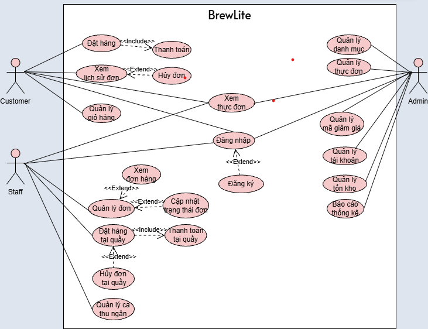

# BrewLite – Tài liệu đặc tả yêu cầu phần mềm rút gọn (SRS)

## 1. Phân loại mức ưu tiên MoSCoW

- **Must:** Yêu cầu bắt buộc phải đáp ứng để hoàn thành phiên bản MVP.
- **Should:** Yêu cầu quan trọng nên triển khai nếu điều kiện cho phép, không làm gián đoạn luồng cốt lõi.
- **Could:** Chức năng bổ sung, xem xét thực hiện khi còn nguồn lực hoặc ở phạm vi mở rộng.
- **Won't:** Nội dung nằm ngoài phạm vi thực hiện của Assignment 2.

---

## 2. Yêu cầu chức năng (Functional Requirements)

### a) Menu

| ID | Mức | Yêu cầu | Tiêu chí chấp nhận |
|---|:---:|---|---|
| FR-01 | Must | Xem danh sách thực đơn sản phẩm. | Người dùng chưa đăng nhập xem được danh sách đồ uống kèm hình ảnh, danh mục, giá bán và trạng thái khả dụng; sản phẩm ẩn hoặc chưa phân bổ tồn kho không mở bán; giao diện hiển thị đủ trạng thái đang tải, trống và lỗi. |
| FR-02 | Should | Tìm kiếm và lọc sản phẩm trên thực đơn. | Người dùng lọc theo danh mục hoặc tìm theo từ khóa nhận đúng danh sách sản phẩm phù hợp; hiển thị thông báo rõ ràng khi không có kết quả. |

### b) Chi tiết sản phẩm

| ID | Mức | Yêu cầu | Tiêu chí chấp nhận |
|---|:---:|---|---|
| FR-03 | Must | Xem thông tin chi tiết đồ uống. | Hiển thị tên, mô tả, hình ảnh, các kích thước, topping và mức giá tương ứng; báo không tìm thấy đối với sản phẩm không tồn tại hoặc đang ẩn. |
| FR-04 | Must | Chọn tùy chọn đồ uống. | Cho phép chọn kích thước thuộc sản phẩm, topping khả dụng và số lượng hợp lệ; hệ thống từ chối các cấu hình tùy chọn không hợp lệ. |

### c) Giỏ hàng

| ID | Mức | Yêu cầu | Tiêu chí chấp nhận |
|---|:---:|---|---|
| FR-05 | Must | Quản lý giỏ hàng. | Món có cùng cấu hình tùy chọn và ghi chú được cộng dồn số lượng, khác cấu hình tách dòng riêng; cho phép tăng/giảm số lượng, xóa món; giữ và đồng bộ giỏ tạm của khách vãng lai sau khi đăng nhập; chặn đặt đơn khi giỏ trống. |
| FR-06 | Must | Tính tổng tiền giỏ hàng tại máy chủ. | Hệ thống tính lại tổng tiền dựa trên bảng giá quản lý tại backend, không tin tưởng số tiền do phía giao diện tự gửi lên. |

### d) Xác thực

| ID | Mức | Yêu cầu | Tiêu chí chấp nhận |
|---|:---:|---|---|
| FR-07 | Must | Đăng ký tài khoản và xác minh OTP qua Gmail. | Email đăng ký là duy nhất; mật khẩu được mã hóa băm bằng `bcrypt`; gửi mã OTP xác minh email qua Gmail và chỉ cho phép đăng nhập sau khi tài khoản đã xác minh thành công. |
| FR-08 | Must | Đăng nhập, duy trì phiên và đăng xuất bằng JWT. | Xác thực thông tin đăng nhập hợp lệ để cấp phiên làm việc bằng JWT; đăng xuất thu hồi phiên hiện tại. |
| FR-09 | Must | Phân quyền người dùng và bảo vệ quyền sở hữu dữ liệu. | Hệ thống kiểm tra xác thực, phân quyền đúng vai trò (`CUSTOMER`, `STAFF`, `ADMIN`) và chỉ cho phép khách hàng truy cập đơn hàng thuộc tài khoản của mình. |

### e) Đặt đơn

| ID | Mức | Yêu cầu | Tiêu chí chấp nhận |
|---|:---:|---|---|
| FR-10 | Must | Kiểm tra đăng nhập trước khi đặt đơn. | Khách chưa đăng nhập khi xác nhận đặt hàng được chuyển sang bước đăng nhập/đăng ký mà không mất giỏ hàng; không tạo đơn online khi chưa xác thực. |
| FR-11 | Must | Áp dụng mã giảm giá và điểm thưởng hợp lệ. | Mỗi đơn online được áp dụng tối đa một mã giảm giá hợp lệ kết hợp quy đổi điểm thưởng (`1 điểm = 100 đồng`), tự động giới hạn điểm sử dụng để giữ mức thanh toán tối thiểu `10.000 đồng`; từ chối khi điểm nhập vượt số dư khả dụng. |
| FR-12 | Must | Kiểm tra tồn kho và tạo đơn hàng chờ thanh toán. | Kiểm tra số lượng tồn khả dụng theo từng kích thước sản phẩm; nếu hết hàng thì từ chối tạo đơn và thông báo rõ; nếu đủ hàng thì tạo đơn chờ thanh toán và giữ chỗ tồn kho, mã giảm giá, điểm thưởng nguyên tử trong một giao dịch. |

### f) Thanh toán

| ID | Mức | Yêu cầu | Tiêu chí chấp nhận |
|---|:---:|---|---|
| FR-13 | Must | Thanh toán đơn hàng bằng Ví hoặc Thẻ mô phỏng. | Hỗ trợ thanh toán qua Ví hoặc Thẻ mô phỏng theo đúng số tiền đơn hàng trên hệ thống; không thu tiền thật và không thu thập số thẻ hay mã CVV. |
| FR-14 | Must | Xử lý kết quả thanh toán và chống giao dịch trùng lặp. | Thanh toán thành công chuyển đơn sang đã thanh toán (`PAID`), trừ tồn kho và cộng điểm thưởng đúng một lần; thanh toán thất bại cho phép thử lại hoặc hủy đơn; trường hợp chưa rõ kết quả được truy vấn đối soát lại; yêu cầu gửi lặp không tạo giao dịch trùng. |
| FR-15 | Could | Tích hợp cổng thanh toán thử nghiệm VNPay Sandbox. | Hỗ trợ tạo giao dịch thanh toán thử nghiệm qua VNPay Sandbox cho đơn từ `10.000 đồng` và xác thực chữ ký phản hồi. |

### g) Lịch sử đơn

| ID | Mức | Yêu cầu | Tiêu chí chấp nhận |
|---|:---:|---|---|
| FR-16 | Must | Xem xác nhận, theo dõi trạng thái và lịch sử đơn hàng. | Hiển thị mã đơn, chi tiết món đã đặt, số tiền, trạng thái xử lý hiện tại và danh sách lịch sử đơn hàng của khách hàng theo thứ tự mới nhất trước. |
| FR-17 | Must | Hủy đơn hàng trước khi pha chế. | Cho phép khách hàng hủy đơn chờ thanh toán để giải phóng giữ chỗ, hoặc hủy và hoàn tiền mô phỏng đối với đơn `PAID` khi nhân viên chưa chuyển sang trạng thái đang pha chế (`PREPARING`). |

### h) Quản lý trạng thái đơn và vận hành cửa hàng

| ID | Mức | Yêu cầu | Tiêu chí chấp nhận |
|---|:---:|---|---|
| FR-18 | Must | Xem và cập nhật trạng thái đơn hàng (`STAFF`). | Chỉ `STAFF` xem hàng đợi đơn đã thanh toán, xem chi tiết đơn và chuyển tuần tự `PAID → PREPARING → READY → COMPLETED`; từ chối mọi thao tác chuyển sai thứ tự và ghi nhận lịch sử trạng thái. |
| FR-19 | Should | Đặt hàng, thanh toán, hủy đơn tại quầy và quản lý ca thu ngân (`STAFF`). | `STAFF` mở/đóng ca thu ngân, tạo đơn tại quầy, thu tiền mặt hoặc mã QR và hỗ trợ hủy/hoàn tiền đơn tại quầy trước khi pha chế. |
| FR-20 | Must | Quản lý danh mục, thực đơn và tồn kho (`ADMIN`). | `ADMIN` thêm, sửa, ẩn/hiện danh mục, sản phẩm, kích thước, topping và cập nhật số lượng tồn kho theo từng kích thước sản phẩm; không làm thay đổi dữ liệu lịch sử các đơn hàng cũ. |
| FR-21 | Must | Quản lý mã giảm giá, tài khoản và báo cáo thống kê (`ADMIN`). | `ADMIN` tạo, sửa, vô hiệu hóa mã giảm giá; quản lý trạng thái và vai trò tài khoản (tự thu hồi phiên khi khóa hoặc đổi quyền); giám sát đơn hàng, đối soát ca thu ngân và xem báo cáo thống kê. |

### i) Yêu cầu mở rộng và ngoài phạm vi

| ID | Mức | Yêu cầu | Tiêu chí xác nhận phạm vi |
|---|:---:|---|---|
| FR-22 | Could | Thông báo đẩy và quản lý nhiều chi nhánh. | Thuộc định hướng mở rộng cho các phiên bản tiếp theo, không bắt buộc nghiệm thu trong MVP. |
| FR-23 | Won't | Giao hàng tận nơi và thanh toán bằng tiền thật. | Không triển khai giao hàng, định vị tài xế, tính phí vận chuyển, thanh toán ngân hàng thật hoặc hoàn tiền tự động qua cổng ngoài. |

---

## 3. Yêu cầu phi chức năng (Non-Functional Requirements)

### a) Hiệu năng

| ID | Mức | Yêu cầu | Tiêu chí chấp nhận |
|---|:---:|---|---|
| NFR-01 | Must | Thời gian phản hồi thực đơn và chi tiết sản phẩm. | Các yêu cầu xem thực đơn và chi tiết sản phẩm phản hồi `p95 ≤ 2.000 ms` trên môi trường kiểm thử/demo với tỷ lệ lỗi máy chủ `< 1%`. |
| NFR-02 | Must | Thời gian xử lý tính tiền, đặt đơn và toàn vẹn đồng thời. | Quá trình tính tổng tiền và tạo đơn hoàn tất trong `p95 ≤ 3.000 ms`; khi nhiều khách đặt cùng đơn vị tồn kho cuối cùng thì tối đa chỉ một đơn thành công, không xảy ra âm tồn kho. |

### b) Bảo mật

| ID | Mức | Yêu cầu | Tiêu chí chấp nhận |
|---|:---:|---|---|
| NFR-03 | Must | Bảo mật mật khẩu, phiên xác thực và phân quyền. | Mật khẩu băm bằng `bcrypt`; kiểm tra xác thực JWT, phân quyền vai trò và quyền sở hữu tại backend; không ghi mật khẩu, mã OTP, token hay khóa bí mật vào log hoặc kho mã nguồn. |
| NFR-04 | Must | Bảo mật hạ tầng triển khai và cơ sở dữ liệu. | Môi trường production hoạt động qua HTTPS; cơ sở dữ liệu PostgreSQL không mở cổng truy cập trực tiếp ra Internet; cấu hình nhạy cảm quản lý qua biến môi trường. |

### c) Tính khả dụng

| ID | Mức | Yêu cầu | Tiêu chí chấp nhận |
|---|:---:|---|---|
| NFR-05 | Must | Giao diện đáp ứng chuẩn mobile-first / PWA. | Hiển thị tương thích, không tràn ngang trên cả điện thoại và máy tính cho toàn bộ quy trình từ xem thực đơn đến theo dõi đơn. |
| NFR-06 | Must | Phản hồi trạng thái giao diện và kiểm tra dữ liệu đầu vào. | Đầy đủ trạng thái đang tải, dữ liệu trống và thông báo lỗi dễ hiểu; kiểm tra dữ liệu ở cả frontend/backend và khóa nút thao tác khi đang gửi yêu cầu. |

### d) Khả năng triển khai

| ID | Mức | Yêu cầu | Tiêu chí chấp nhận |
|---|:---:|---|---|
| NFR-07 | Must | Đóng gói chạy độc lập tại môi trường local. | Có thể sao chép kho mã nguồn mới, cấu hình môi trường mẫu, khởi chạy bằng Docker Compose và nạp migration/dữ liệu mẫu để vận hành đầy đủ hệ thống. |
| NFR-08 | Must | Tự động hóa kiểm tra CI/CD, kiểm tra sức khỏe dịch vụ và khôi phục. | Mọi Pull Request chạy tự động `Install → Lint → Unit Test → Build` (chặn hợp nhất nếu lỗi); quy trình triển khai tự động kiểm tra sức khỏe dịch vụ sau phát hành và có phương án rollback khi sự cố. |

---

## 4. Sơ đồ Use-Case tổng quát của toàn hệ thống

Sơ đồ Use-Case tổng quát mô tả các chức năng của hệ thống **BrewLite** đối với ba tác nhân người dùng chính gồm **Customer**, **Staff** và **Admin**:

- **Tệp nguồn sơ đồ:** `docs/diagrams/usecase-overview.vpd`
- **Tệp ảnh kết xuất:** `docs/diagrams/usecase-overview.png`

