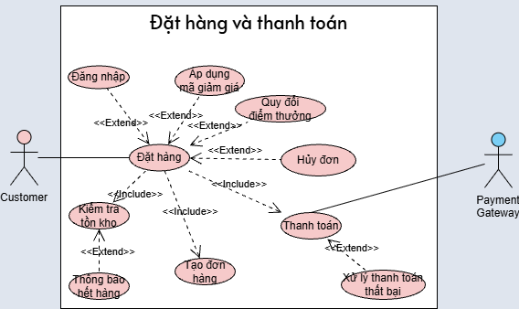

# BrewLite – Đặc tả Use-Case trọng tâm: Đặt và thanh toán đơn hàng

## 1. Sơ đồ Use-Case trọng tâm

- **Tệp nguồn sơ đồ:** `docs/diagrams/usecase-checkout.vpd`
- **Tệp ảnh kết xuất:** `docs/diagrams/usecase-checkout.png`

---

## 2. Bảng đặc tả Use-Case

| Mục | Nội dung đặc tả |
|---|---|
| **Use Case Name** | Đặt và thanh toán đơn hàng |
| **Actors** | **Primary:** Khách hàng (`Customer`) **Secondary:** Cổng thanh toán (Ví/Thẻ mô phỏng, mở rộng VNPay Sandbox) |
| **Description** | Khách hàng xác nhận mua các sản phẩm đã chọn từ giỏ hàng hoặc từ hộp thoại thông báo sau khi thêm món. Hệ thống kiểm tra trạng thái đăng nhập, cho phép áp dụng mã giảm giá và quy đổi điểm thưởng (nếu có), tính lại tổng tiền trên máy chủ, kiểm tra và giữ chỗ tồn kho để tạo đơn chờ thanh toán, sau đó xử lý giao dịch qua cổng thanh toán và cập nhật kết quả đơn hàng. |
| **Trigger** | Khách hàng nhấn nút **"Xác nhận mua"** tại giỏ hàng hoặc trên hộp thoại thông báo ngay sau khi thêm sản phẩm vào giỏ. |
| **Preconditions** | Giỏ hàng (giỏ tạm trên trình duyệt hoặc giỏ đã đồng bộ tài khoản) có ít nhất 01 sản phẩm đã chọn cấu hình kích thước, topping và số lượng hợp lệ. |
| **Postconditions** | **Thành công:** Đơn hàng chuyển sang trạng thái đã thanh toán (`PAID`); tồn kho, lượt dùng mã giảm giá và điểm thưởng đã sử dụng được trừ chính thức; khách được cộng điểm thưởng tích lũy mới (`1 điểm / 10.000 đồng`); các món đã đặt được xóa khỏi giỏ hàng; hệ thống tạo thông báo trong ứng dụng, hiển thị mã đơn cho khách và đưa đơn `PAID` vào danh sách xử lý của Nhân viên / giám sát của Quản trị viên. **Thất bại / Hủy đơn:** Không phát sinh đơn hàng `PAID`; nếu khách hủy đơn chờ thanh toán (hoặc đơn hết hạn 10 phút), đơn chuyển sang `CANCELLED`, toàn bộ tồn kho, mã giảm giá và điểm thưởng đang giữ chỗ được giải phóng, giỏ hàng được giữ nguyên. |
| **Normal Flow** | 1. Khách hàng xem giỏ hàng (hoặc hộp thoại thêm món thành công) và nhấn **"Xác nhận mua"**. 2. Hệ thống kiểm tra trạng thái đăng nhập của khách hàng. *(E1)* 3. Khách hàng nhập mã giảm giá và/hoặc số điểm thưởng muốn quy đổi (nếu không dùng ưu đãi, bỏ qua chuyển sang bước 6). 4. Hệ thống kiểm tra điều kiện mã giảm giá (tồn tại, đang kích hoạt, còn hạn, còn lượt sử dụng, đạt giá trị đơn tối thiểu) và tính mức giảm. *(E2)* 5. Hệ thống kiểm tra số điểm thưởng khách nhập không vượt số dư khả dụng và tự động giới hạn điểm sử dụng để giữ mức thanh toán tối thiểu `10.000 đồng`. *(E3)* 6. Hệ thống tính lại tổng tiền phải thanh toán tại máy chủ và hiển thị cho khách xác nhận. 7. Khi khách xác nhận tạo đơn, hệ thống kiểm tra số lượng tồn kho khả dụng của từng kích thước sản phẩm trong giỏ. *(E4)* 8. Hệ thống tạo đơn hàng ở trạng thái chờ thanh toán (`PENDING`), đồng thời giữ chỗ nguyên tử tồn kho, lượt mã giảm giá và điểm thưởng trong thời hạn 10 phút. 9. Khách hàng chọn phương thức thanh toán và hệ thống gửi yêu cầu thanh toán (kèm khóa chống trùng) đến cổng thanh toán. *(E5)* 10. Cổng thanh toán xác nhận giao dịch thành công: hệ thống cập nhật đơn sang `PAID`, trừ chính thức tồn kho/điểm/lượt mã, cộng điểm tích lũy mới, xóa các món đã mua khỏi giỏ, tạo thông báo trong ứng dụng và hiển thị màn hình kết quả kèm mã đơn hàng. |
| **Exception** | **E1.** Khách hàng chưa đăng nhập tài khoản (tại bước 2). **E2.** Mã giảm giá không tồn tại, hết hạn, hết lượt dùng hoặc chưa đủ giá trị đơn tối thiểu (tại bước 4). **E3.** Số điểm thưởng nhập vào âm hoặc vượt quá số dư điểm khả dụng trong ví khách hàng (tại bước 5). **E4.** Một hoặc nhiều sản phẩm trong giỏ không đủ số lượng tồn kho khả dụng hoặc đã ngừng bán (tại bước 7). **E5.** Giao dịch thanh toán bị từ chối/thất bại hoặc quá thời gian chờ phản hồi chưa rõ kết quả (tại bước 9). |
| **Alternative Flow** | **A1 (xử lý E1):** Hệ thống hiển thị biểu mẫu yêu cầu đăng nhập (hoặc đăng ký tài khoản mới), tự động đồng bộ gộp giỏ hàng tạm vào tài khoản sau khi xác thực thành công, rồi tiếp tục bước 3. **A2 (xử lý E2):** Hệ thống thông báo lý do mã giảm giá không hợp lệ; khách hàng nhập lại mã khác (quay lại bước 3) hoặc xóa mã để tiếp tục (sang bước 5). **A3 (xử lý E3):** Hệ thống báo lỗi vượt số dư điểm khả dụng; khách hàng điều chỉnh lại số điểm hợp lệ (quay lại bước 3) hoặc đặt về `0` điểm (sang bước 6). **A4 (xử lý E4):** Hệ thống từ chối tạo đơn, thông báo rõ món bị thiếu tồn kho và đồng bộ lại giỏ hàng để khách điều chỉnh số lượng hoặc đổi món khác. **A5 (xử lý E5):** Nếu giao dịch thất bại, hệ thống giữ nguyên phần giữ chỗ và cho phép khách chọn thanh toán lại (quay lại bước 9, tối đa 3 lần trong thời hạn 10 phút) hoặc chủ động nhấn **Hủy đơn** để chuyển đơn sang `CANCELLED` và giải phóng toàn bộ tài nguyên giữ chỗ; nếu kết quả chưa xác định, hệ thống giữ trạng thái chờ đối soát và chặn tạo giao dịch mới để tránh trừ tiền trùng. |

---

## 3. Liên kết Use-Case với mã yêu cầu tương ứng

| Nhóm yêu cầu | Mã yêu cầu trong [srs.md](./srs.md) | Nội dung ánh xạ trong Use-Case |
|---|---|---|
| **Yêu cầu chức năng (`FR`)** | `FR-06` | Tính lại tổng tiền đơn hàng chính xác tại máy chủ (bước 6). |
| | `FR-10` | Kiểm tra đăng nhập trước khi đặt đơn và giữ giỏ hàng qua `E1` / `A1` (bước 2). |
| | `FR-11` | Kiểm tra mã giảm giá và quy đổi điểm thưởng giữ mức tối thiểu `10.000 đồng` qua `E2, E3` / `A2, A3` (bước 3–5). |
| | `FR-12` | Kiểm tra tồn kho theo kích thước và tạo đơn `PENDING` giữ chỗ nguyên tử trong 10 phút qua `E4` / `A4` (bước 7–8). |
| | `FR-13` | Gửi yêu cầu thanh toán qua Ví/Thẻ mô phỏng theo số tiền đơn hàng trên hệ thống (bước 9). |
| | `FR-14` | Xác nhận `PAID`, tích điểm, thử lại khi thất bại, đối soát khi chưa rõ kết quả và chống trùng giao dịch qua `E5` / `A5` (bước 9–10). |
| | `FR-15` | Mở rộng thanh toán qua cổng thử nghiệm VNPay Sandbox (bước 9). |
| | `FR-16`, `FR-17` | Tạo thông báo, hiển thị xác nhận mã đơn sau thanh toán và hỗ trợ hủy đơn giải phóng tài nguyên (bước 10, `A5`). |
| **Yêu cầu phi chức năng (`NFR`)** | `NFR-02` | Xử lý tính tiền, tạo đơn nhanh và đảm bảo tính nguyên tử khi đặt đồng thời vào tồn kho cuối. |
| | `NFR-03` | Xác thực JWT, kiểm tra phân quyền `CUSTOMER` và quyền sở hữu đơn hàng tại backend. |
| | `NFR-05`, `NFR-06` | Giao diện mobile-first, hiển thị lỗi kiểm tra dữ liệu rõ ràng và khóa nút bấm khi đang gửi yêu cầu. |
